# 目标 ER 图

实线关系表示同库数据库外键；虚线无法由 Mermaid ER 直接表达，图中标注为“逻辑引用”的跨库关系只由 Feign/Service 校验，不建立 MySQL 外键。

```mermaid
erDiagram
    ROLES ||--o{ USERS : "FK role_key"
    PEOPLE ||--o| USERS : "FK person_id"
    USERS ||--o{ AUTH_TOKENS : "FK user_id"
    ROLES ||--o{ MESSAGES : "FK target_role"
    PEOPLE ||--o{ FACES : "FK person_id"
    PEOPLE ||--o{ VEHICLES : "FK owner_id"

    APPOINTMENTS ||--o{ APPOINTMENT_REVIEWS : "FK appointment_id"

    GATES ||--o{ DEVICES : "FK gate_id"
    GATES ||--o{ ACCESS_RULES : "FK gate_id"
    GATES ||--o{ ACCESS_RECORDS : "FK gate_id"

    PEOPLE {
      varchar id PK
      varchar person_code UK
      varchar name
      varchar person_type
      varchar status
    }
    USERS {
      varchar id PK
      varchar username UK
      varchar role_key FK
      varchar person_id FK
      varchar status
    }
    ROLES {
      varchar role_key PK
      varchar label
      boolean enabled
    }
    AUTH_TOKENS {
      varchar id PK
      varchar token_type
      char token_digest UK
      varchar user_id FK
      datetime expires_at
    }
    FACES {
      varchar id PK
      varchar person_id FK
      varchar slot_key
      varchar status
    }
    VEHICLES {
      varchar id PK
      varchar owner_id FK
      varchar plate_no UK
      varchar status
    }
    MESSAGES {
      varchar id PK
      varchar target_role FK
      varchar title
      datetime created_at
    }
    AUDIT_LOGS {
      varchar id PK
      datetime occurred_at
      varchar actor_id "logical person/user reference"
      varchar action
      varchar result
    }

    APPOINTMENTS {
      varchar id PK
      varchar visitor_id "logical user reference"
      varchar host_id "logical user reference"
      datetime visit_start
      varchar status
      varchar issuance_operation_id UK
      varchar issuance_phase
    }
    APPOINTMENT_REVIEWS {
      varchar id PK
      varchar appointment_id FK
      bigint decision_version
      varchar action
      datetime occurred_at
    }

    GATES {
      varchar id PK
      varchar name UK
      time open_from
      time open_to
      varchar status
    }
    DEVICES {
      varchar id PK
      varchar gate_id FK
      varchar name
      varchar status
    }
    ACCESS_RULES {
      varchar id PK
      varchar role_key "logical role reference"
      varchar method
      varchar gate_id FK
      time allowed_from
      time allowed_to
    }
    ACCESS_SETTINGS {
      varchar id PK
      int visitor_qr_minutes
      decimal face_threshold
      boolean high_risk_auto_block
    }
    QR_CODES {
      varchar id PK
      varchar token UK
      varchar subject_id "logical person reference"
      varchar appointment_id UK "logical appointment reference"
      datetime valid_to
      varchar issuance_phase
    }
    ACCESS_RECORDS {
      varchar id PK
      varchar request_id UK
      varchar person_id "logical person reference"
      varchar gate_id FK
      datetime occurred_at
      varchar exception_sync_status
    }

    EXCEPTIONS {
      varchar id PK
      varchar source_event_id UK "logical access reference"
      varchar person_id "logical person reference"
      varchar gate_id "logical gate reference"
      varchar status
      bigint version
    }
    BLACKLIST {
      varchar id PK
      varchar credential_no
      varchar status
      datetime created_at
    }

    PEOPLE ||..o{ APPOINTMENTS : "visitor/host logical"
    ROLES ||..o{ ACCESS_RULES : "role logical"
    PEOPLE ||..o{ QR_CODES : "subject logical"
    APPOINTMENTS ||..o| QR_CODES : "appointment logical"
    PEOPLE ||..o{ ACCESS_RECORDS : "person logical"
    ACCESS_RECORDS ||..o| EXCEPTIONS : "source event logical"
    PEOPLE ||..o{ EXCEPTIONS : "person logical"
```

## 关系说明

- 同库外键：用户域的角色、人员、账号、令牌、人脸、车辆；预约与审批历史；通行域校门与设备/规则/记录。
- 跨库逻辑关联：预约中的 visitor/host、规则中的 role、二维码中的 appointment/person、通行和异常中的 person/gate。写入时通过 Feign 查询校验，读取时允许服务降级返回快照。
- 一对一合并：appointment 与 issuance、qr_code 与 qr_issuance 生命周期一致，因此用聚合根状态列表达，不再建独立一对一表。
- 多对多规则：角色—校门—通行方式不是用逗号字段，也不额外建两张关联表；`access_rules` 自身作为三元关联关系，每行一个原子组合。
