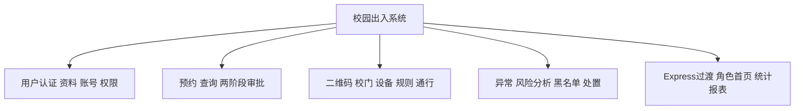
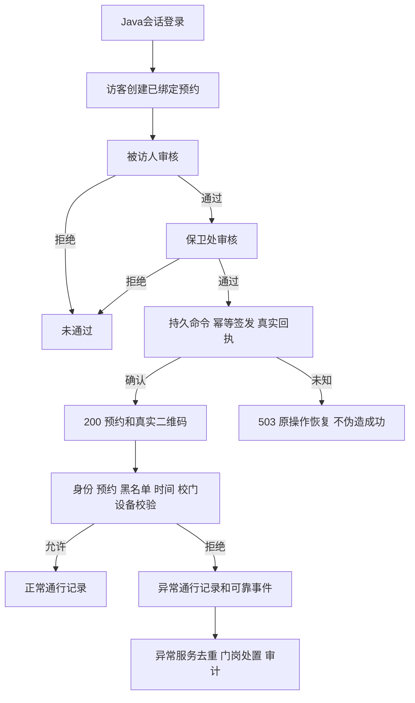
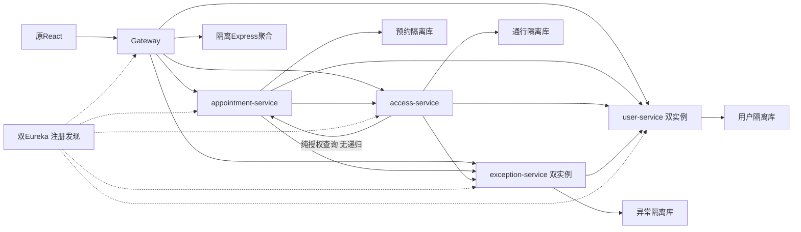
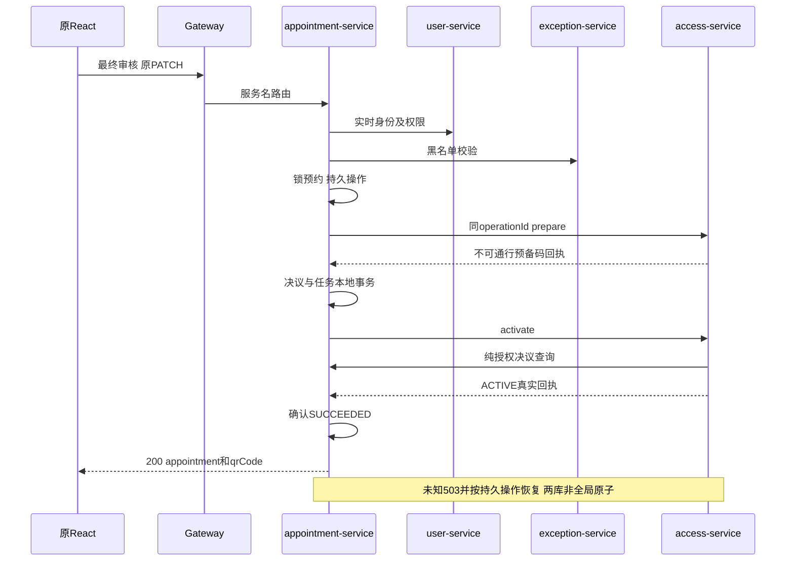

# P5系统集成审计

已完成本轮前置分析及隔离集成核查，停止等待下一次审批。P4-C此前范围按用户确认通过，历史阶段文档“待审核/未进入下一阶段”保留为历史，当前以P5授权和本文件为准。

## 真实完成口径

原68条API：Java62（91.18%），Express过渡5（7.35%，四聚合加health），未实现/禁用1（1.47%，人员删除）。排除health业务分母67则Java62/67=92.54%。不计算虚假的总体完成率：62包含仅批准范围内的实现，最终审核无绑定分支503、真实短信送达等仍未完成。新增撤码/内部接口不计原68分子。逐条清单见[p5-final-api-inventory.md](p5-final-api-inventory.md)。

静态页面调用候选Java47条，其余15条无当前活动页面直接调用；不能把47当作全UI测试通过数。真实Edge本轮55项；完整集成共436项实际断言，见[p5-integration-test-evidence.md](p5-integration-test-evidence.md)。本轮Java/React/后端源码哈希不变，无新Maven构建；沿用已审核P4-C build-3产物并核对JAR哈希。

## 四服务与数据库

|域|已实现|独占数据|
|---|---|---|
|user-service|认证/6角色/人员与账号增改查/资料/车辆/人脸元数据/消息/审计|roles、role_profiles、users、people、sessions、vehicles、faces、messages、logs；辅助验证码/审计表|
|appointment-service|5条原API、两阶段状态/归属/黑名单/跨服务身份、已绑定最终签发恢复|appointments及审批历史/outbox/issuance命令；不写QR表|
|access-service|15条原API+撤码、真实QR、规则/设备/校门、记录、幂等与事件|qr_codes、access_records、gates、devices、access_rules、settings及请求/outbox/签发槽|
|exception-service|10条原API、原本地风险/问答、单向处置、名单、事件inbox/审计|exceptions、blacklist及去重/请求/outbox；不跨库写用户/通行|

六角色名义不变，真实Session权威在Java，P2客户端Token库内摘要、不接管原生产会话。Gateway清理伪造身份头；Express每请求受保护获取当前身份和领域投影，退出/禁用/撤权不信旧内存缓存。库账号隔离，后台恢复忽略HOLD；本轮HOLD摘要前后相同，无人工状态修改。

## Express仍不可移除

backend/p4c-legacy-adapter仅在隔离副本承接GET dashboard/admin、dashboard/:role、reports/summary、reports/access及health，并为P2注册/创建访客提供黑名单代理。预约/通行已按Eureka直接调用正式exception；桥接自身不再写异常/黑名单，聚合读取Java投影。角色首页、QR展示和普通人记录/异常页仍依赖它；停掉Node桥后不能声称原React全功能可用。

未来“停Node后端”需另批Java应用聚合：拟user-service新增DashboardController、ReportController及聚合Service/Impl，三个受保护领域Feign客户端/DTO，Gateway移除相应legacy路由；health需单独确定兼容脱敏方案，不能随手替换旧字段。仍须保留本人/管理员范围、中文字段/排序和聚合故障明确失败，不能全库共享。未在本轮实现，也不把它混入A–F审批。

## 当前功能结构与流程（真实范围文本图）

以上是文档文本图，尚未整理成带图号的正式Word报告，也不把绘图存在算作课程提交完成。数据库字段/关系基线见database-dictionary及各域SQL；一对多/多对多说明和课程报告缺口见[p5-course-rubric-matrix.md](p5-course-rubric-matrix.md)。

## 收尾结论及下一步精确范围

六项遗留只完成方案，无实现：[p5-remaining-features-plan.md](p5-remaining-features-plan.md)。建议下一批仅审批原前端App.jsx、config/roles.js、pages/FeaturePages.jsx、必要api/client.js的A/B/F局部入口；不改后端API/库。C只读查询需独立审批新增预约控制器/服务/DAO/DTO；C人工恢复、D身份关联、E人员删除分别审批，不能捆绑。Java聚合迁移另列一批，不借本轮分析直接实施。

当前演示可在已准备机器上一键启动正常闭环；主要阻塞是正式报告与五分钟彩排，以及如果老师要求纯UI扫码或完全停Node，需相应批准前端入口/Java聚合。真实短信、硬件、多机HA、全站移动端、HOLD人工恢复、未绑定场景和人员删除可如实列限制，但最终课程接受程度由老师决定。
# 2026-10-20 第二批集成补充

A/B/F局部前端已实现并隔离联调，最终64项页面专项、56项整体回归通过，生产构建通过。四个授权前端文件变化，Java/Gateway/Express业务文件不变；原19表与备份一致。真实页面调用新扫码/规则验证及账号状态接口，Express过渡聚合依赖仍存在，68 API迁移统计未改变。测试进程已全部关闭。详见[p5-frontend-acceptance.md](p5-frontend-acceptance.md)及[p5-frontend-browser-regression.md](p5-frontend-browser-regression.md)。下文原前置核查证据保留；其中尚无A/B/F入口的描述属于此前时点，不代表当前状态。

