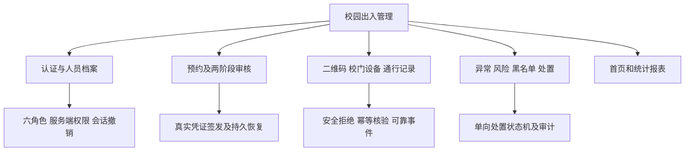
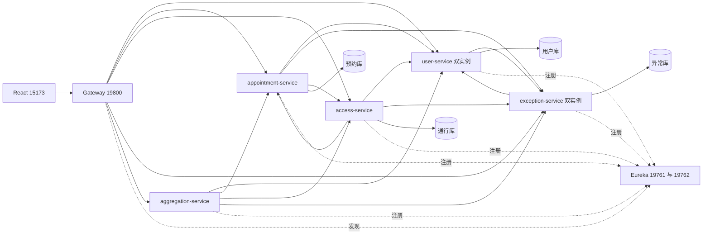
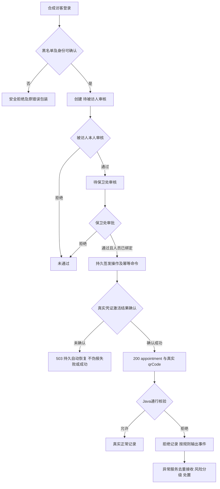
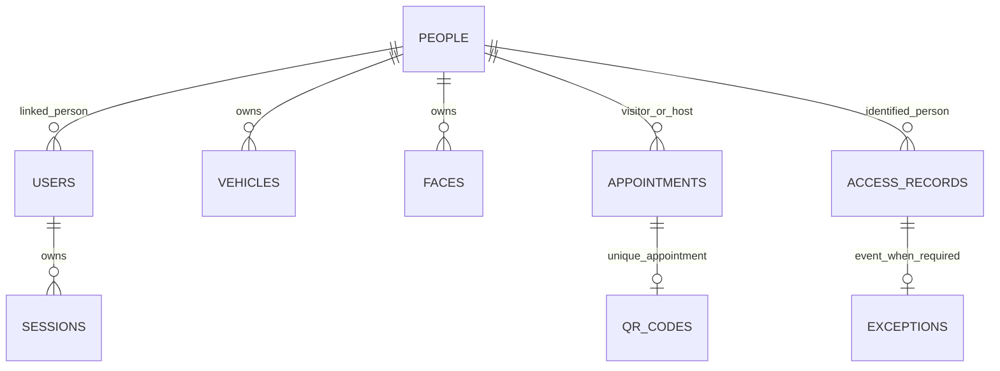
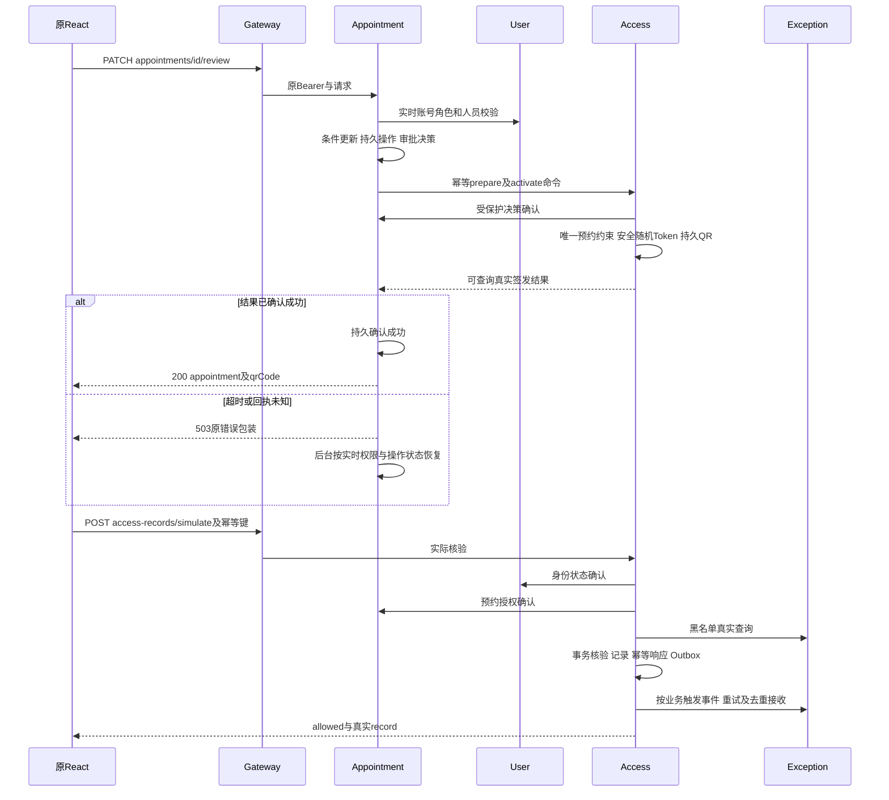

# 课程报告整编提纲与图稿

依据真实任务书与评分标准的只读提取：[任务书](p5-evidence/course-task.txt)、[评分标准](p5-evidence/course-rubric.txt)、[原件路径与SHA256](p5-evidence/course-sources.json)。这是可整编的内容提纲与源码图稿，不是已提交的Word终稿或教师签署材料。

## 软件开发日志（20%评分材料）

按本人真实每两次上机时间编写一篇：本次目标、实际修改类/方法及作用、构建与运行、失败和修正、下次计划。使用P0–P7阶段报告与原始日志作为事实来源；机器执行时间不能冒充到课时间。姓名、学号、班级、实际签到、按时提交情况由本人填写；没有证据的事项保持空白。

## 系统设计报告（报告部分的20%）

1. 背景、六角色与功能范围：校园人员、访客两阶段预约、凭证核验、异常处置、统计；明确禁用删除/无绑定/HOLD限制。
2. 总体结构：原React + Gateway + 四业务域 + 只读聚合 + 双Eureka；各域独立MySQL账号/Schema。
3. 前后台业务流程：注册登录、被访人审核、保卫处批准、真实QR、幂等核验、异常风险及处置。
4. 概念模型、逻辑结构与物理设计：至少选择users/people/sessions/appointments/qr_codes/access_records/exceptions/blacklist，逐字段填写中文名、字段名、类型/长度、小数、主键、索引、备注。原[数据字典](database-dictionary.md)与本轮真实database-audit分别是原库及Java隔离库事实，不能混用DDL。
5. UML概念类关系、主要顺序图、错误边界：明确关系ID与物理FK区别。

### 图1：功能结构

### 图2：当前微服务架构

箭头包含既有按需回调，A/C之间使用受保护决策查询，不是在同一请求递归签发；U/E黑名单和审计分别调用不同职责，禁止用图中的双向依赖声称不存在耦合。聚合不连数据库；旧Express只保留源码，不运行。

### 图3：主业务流程

### 图4：概念关系（不是跨库物理外键）

users.person_id与sessions.user_id在用户库有实际FK；预约、QR、通行、异常之间的ID是逻辑关联，通过内部API/幂等约束维护。roles是角色字典，users.role为单个角色键；不能虚构已实现的多角色RBAC关联表。规则的角色/校门/核验方法组合以字段/JSON表达，没有独立多对多嵌套resultMap代码。MyBatis单实体真实完成；一对多、多对多在设计说明中据实解释，若教师坚持额外代码示例需另行批准。

### 图5：最终审批及核验核心顺序

以上是协议级顺序摘要，不把网络调用包进一个全局事务；具体持久状态/故障补偿见[p4-qr-issuance-design.md](p4-qr-issuance-design.md)及[p4-qr-consistency-test.md](p4-qr-consistency-test.md)。

## 系统开发报告（报告部分的80%）

1. 开发环境与兼容决策：Java11独立环境、Boot/Cloud BOM，旧Ribbon/Hystrix真实Maven及P1实验，不用网上推断代替运行。
2. 创建Eureka双节点与peer配置，展示注册和单节点恢复证据，说明单机HA局限。
3. Ribbon服务列表/过滤链与RoundRobin：引用P1诊断及P6/P7双实例实际计数。
4. OpenFeign各Client、内部服务认证、超时与DTO/Map响应；解释没有硬编码业务实例地址。
5. Hystrix真实错误、短路、开路及探测恢复；fallback不是开路证据，统计失败不能返回假零。
6. Gateway配置及身份头清理、P6无Express兜底、删除禁用、未知签发503保护。
7. 四业务域按Controller→Service接口/Impl→DAO→Entity/DTO→Mapper XML逐个说明类和主要方法；不要整段粘贴全部源码。聚合无持久化，不强造DAO。
8. MyBatis参数化SQL、域内事务、乐观/条件更新、唯一约束、Outbox/Inbox和幂等键；真实回滚/并发证据。
9. 68 API对照、六角色范围、React可操作入口与脚本接口区别，已批准契约差异单列。
10. 测试、失败日志与修正、原数据/备份保全、风险、课程建议与本人心得。不得把未实现限制写成已完成。

建议附录：最终API矩阵、物理字段/索引清单、版本依赖、构建日志、脱敏截图、5分钟脚本。统一图号/表号和参考文献由正式排版阶段完成，本轮不冒称终稿已验收。
